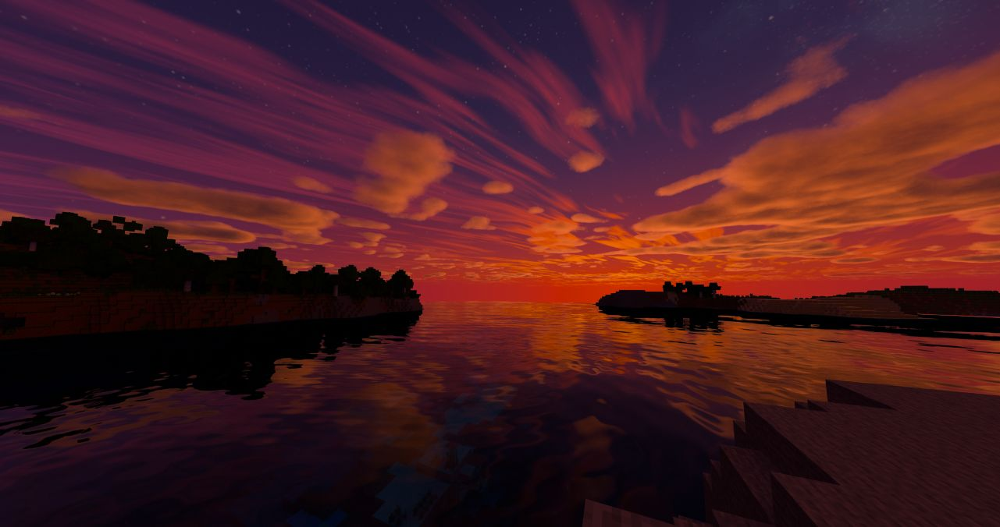
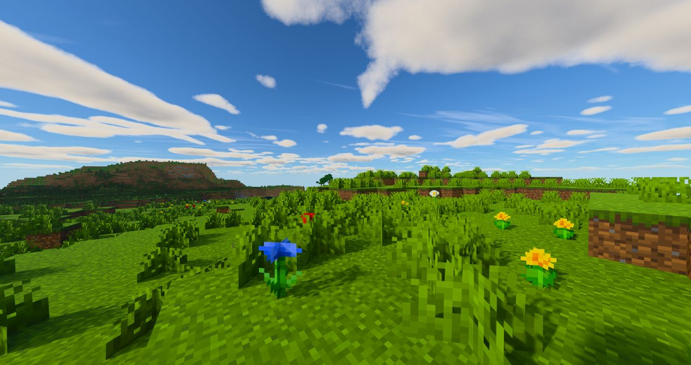
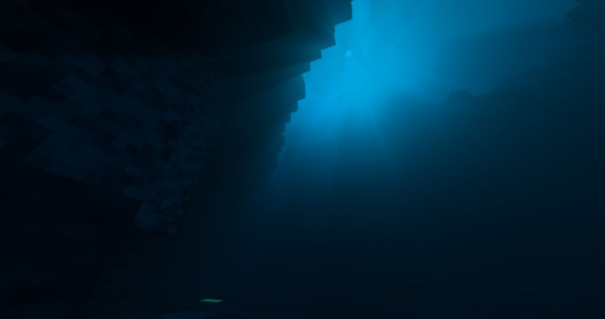
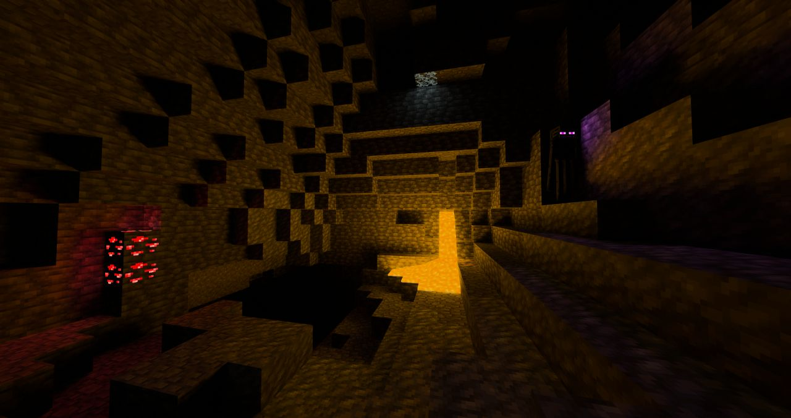
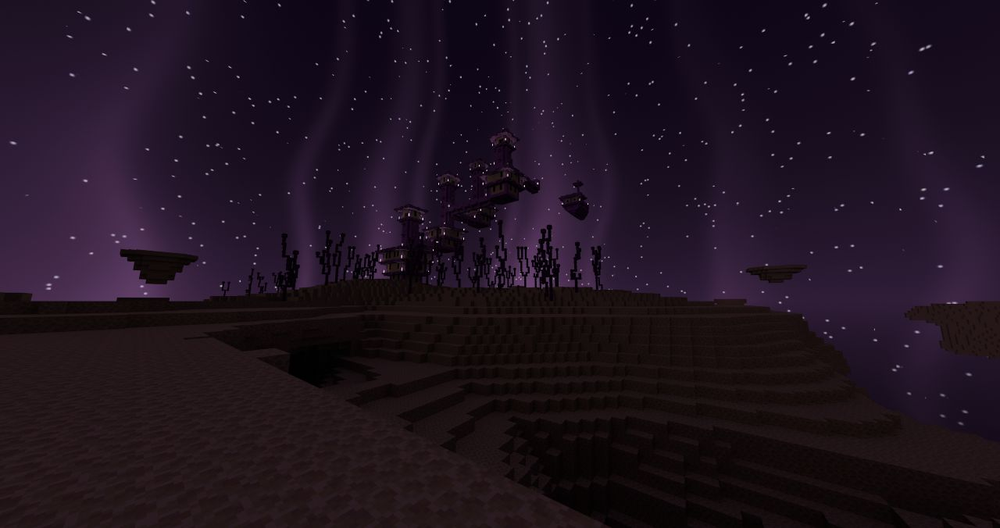

**English** | [Русский](README.ru.md) | [繁體中文](README.zh-TW.md) | [简体中文](README.zh-CN.md)

# ParacosmShader

A path-traced shader pack for [Radiance](https://github.com/Minecraft-Radiance/Radiance) (MCVR), the Vulkan ray tracing mod for Minecraft. It is a modified version of Radiance's built-in **Advanced** pack and is shown in the shader pack list as **Paracosm Shader**.

ParacosmShader is a joint project. It brings together the Advanced Sunlit work by TimON and parts of the [Chromance-VKPT](https://github.com/Akiraoo/Chromance-VKPT) pack by Akiraoo.

## Screenshots

  

<table>
  <tr>
    <td width="50%"> Daylight and clouds</td>
    <td width="50%"> Underwater</td>
  </tr>
  <tr>
    <td width="50%"> Caves: lava and glowing redstone ore</td>
    <td width="50%"> The End</td>
  </tr>
</table>

## Features

- **Daylight and sky**: strong direct sunlight (about 5:1 sun to sky at noon), a softer golden hour, clearer and bluer distance haze, and a round sun with soft, darkened edges.
- **Night sky**: its own stars, nebulae and distant galaxies that turn with the sun and moon, plus an aurora in cold biomes (or every night).
- **Clouds**: volumetric clouds and a thin cirrus layer high above them.
- **Water**: calm water with fine ripples, clear turquoise shallows, caustics and deep water that fades into dark blue.
- **Block light**: two lighting modes for glowing blocks:
  - **ReSTIR** (default): smooth light, reused over time and between pixels.
  - **RIS**: the Chromance light sampling method; no history, so light never lags or trails behind.
- **Glowing blocks**: separate brightness for magma, glowing redstone ore and glow lichen; glowing mob eyes no longer disappear.
- **Linear texture colours**: textures and biome colours are decoded from sRGB, so they keep their contrast instead of looking pale and dusty.
- **First-person body** (optional), **The End** sky with light beams and stars, and **post-processing** (contrast, sharpening, saturation, vibrance).

## Requirements

- Minecraft 1.21.4 with Fabric
- Radiance (MCVR) 0.1.6
- A GPU with hardware ray tracing (NVIDIA RTX recommended; DLSS Ray Reconstruction gives the cleanest image)

## Installation

1. Download the pack from [Releases](https://github.com/Akiraoo/ParacosmShader/releases/latest) (or clone this repository) into `<minecraft instance>/shaderpacks/`. A folder works as well as a zip.
2. In game, open Radiance's settings, go to the shader pack page and select **Paracosm Shader**.
3. After updating the pack, press **Reset all** on the shader pack settings page. Radiance stores every setting value the first time a pack is loaded, so new defaults only apply after a reset.

## Contributing

Changes go through pull requests: create a branch from `main`, make your change, and open a pull request. The other maintainer tests it in game before it is merged.

## Credits

- **TimON** ([Tarry665](https://github.com/Tarry665)): Advanced Sunlit — daylight, sky, night sky, aurora, water, clouds, End sky, first-person body, post-processing.
- **Akiraoo** ([Akiraoo](https://github.com/Akiraoo)): Chromance-VKPT — the RIS light sampling method and the cloud work.
- **The Radiance team**: the Radiance mod and its built-in Advanced shader pack, which this pack is based on.

## License

ParacosmShader is released under the GPL-3.0 license. See [LICENSE](LICENSE) for details.
