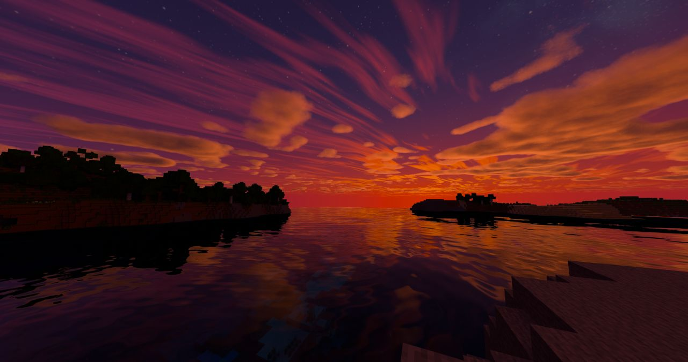
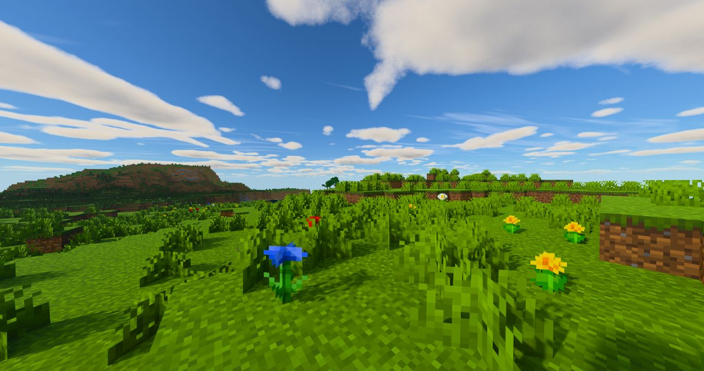
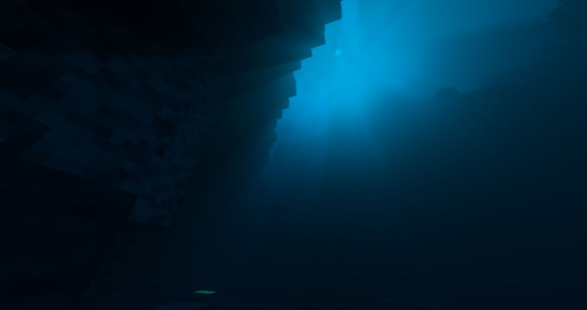
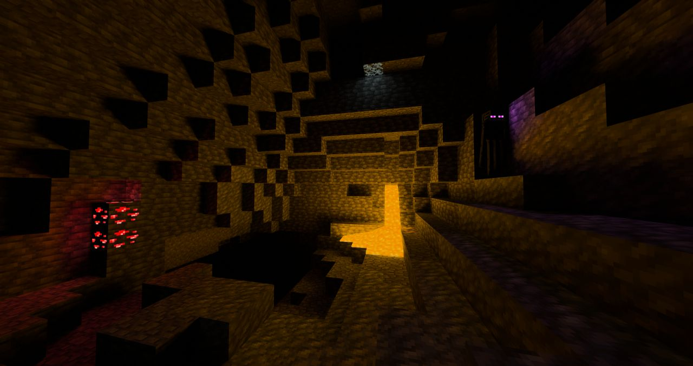
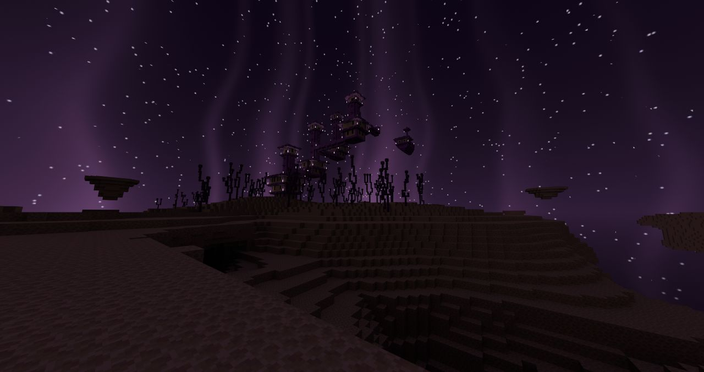

[English](README.md) | **Русский** | [繁體中文](README.zh-TW.md) | [简体中文](README.zh-CN.md)

# ParacosmShader

Шейдерпак с трассировкой путей для [Radiance](https://github.com/Minecraft-Radiance/Radiance) (MCVR) — Vulkan-мода трассировки лучей для Minecraft. Это модифицированная версия встроенного пака **Advanced** из Radiance, в списке шейдеров он отображается как **Paracosm Shader**.

ParacosmShader — совместный проект. Он объединяет работу TimON над Advanced Sunlit и части пака [Chromance-VKPT](https://github.com/Akiraoo/Chromance-VKPT) от Akiraoo.

## Скриншоты

  

<table>
  <tr>
    <td width="50%"> Дневной свет и облака</td>
    <td width="50%"> Под водой</td>
  </tr>
  <tr>
    <td width="50%"> Пещеры: лава и светящаяся руда редстоуна</td>
    <td width="50%"> Энд</td>
  </tr>
</table>

## Возможности

- **Дневной свет и небо**: сильный прямой солнечный свет (около 5:1 солнце к небу в полдень), более мягкий золотой час, более чёткая и голубая дымка вдали и круглое солнце с мягким затемнением к краям.
- **Ночное небо**: собственные звёзды, туманности и далёкие галактики, которые поворачиваются вместе с солнцем и луной, а также северное сияние в холодных биомах (или каждую ночь).
- **Облака**: объёмные облака и тонкий слой перистых облаков высоко над ними.
- **Вода**: спокойная вода с мелкой рябью, прозрачное бирюзовое мелководье, каустика и глубокая вода, темнеющая до тёмно-синего.
- **Свет от блоков**: два режима освещения для светящихся блоков:
  - **ReSTIR** (по умолчанию): плавный свет, который переиспользуется во времени и между пикселями.
  - **RIS**: метод выборки света из Chromance; без истории, поэтому свет никогда не отстаёт и не оставляет шлейфов.
- **Светящиеся блоки**: отдельная яркость для магмы, светящейся руды редстоуна и светящегося лишайника; светящиеся глаза мобов больше не пропадают.
- **Линейные цвета текстур**: текстуры и цвета биомов декодируются из sRGB, поэтому сохраняют контраст, а не выглядят блёклыми и пыльными.
- **Тело от первого лица** (опционально), небо **Энда** с лучами света и звёздами и **постобработка** (контраст, резкость, насыщенность, вибрантность).

## Требования

- Minecraft 1.21.4 с Fabric
- Radiance (MCVR) 0.1.6
- Видеокарта с аппаратной трассировкой лучей (рекомендуется NVIDIA RTX; DLSS Ray Reconstruction даёт самую чистую картинку)

## Установка

1. Скачайте пак из [Releases](https://github.com/Akiraoo/ParacosmShader/releases/latest) (или клонируйте этот репозиторий) в папку `<папка сборки minecraft>/shaderpacks/`. Подойдёт как папка, так и zip-архив.
2. В игре откройте настройки Radiance, перейдите на страницу шейдерпаков и выберите **Paracosm Shader**.
3. После обновления пака нажмите **Reset all** на странице настроек шейдерпака. Radiance сохраняет значения всех настроек при первой загрузке пака, поэтому новые значения по умолчанию применяются только после сброса.

## Участие в разработке

Изменения вносятся через pull request: создайте ветку от `main`, внесите изменение и откройте pull request. Второй мейнтейнер проверит его в игре, прежде чем оно будет принято.

## Авторы

- **TimON** ([Tarry665](https://github.com/Tarry665)): Advanced Sunlit — дневной свет, небо, ночное небо, северное сияние, вода, облака, небо Энда, тело от первого лица, постобработка.
- **Akiraoo** ([Akiraoo](https://github.com/Akiraoo)): Chromance-VKPT — метод выборки света RIS и работа над облаками.
- **Команда Radiance**: мод Radiance и его встроенный шейдерпак Advanced, на котором основан этот пак.

## Лицензия

ParacosmShader распространяется по лицензии GPL-3.0. Подробности в файле [LICENSE](LICENSE).
