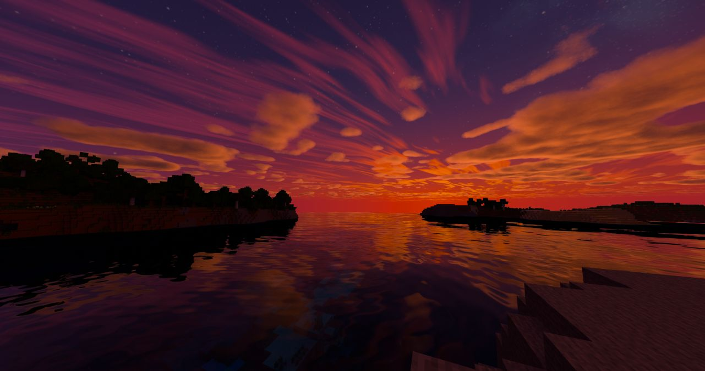
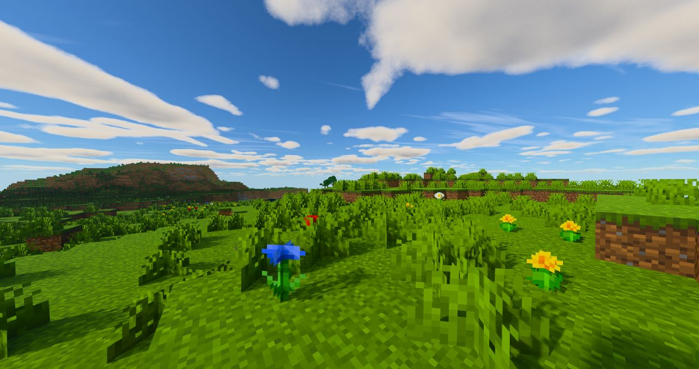
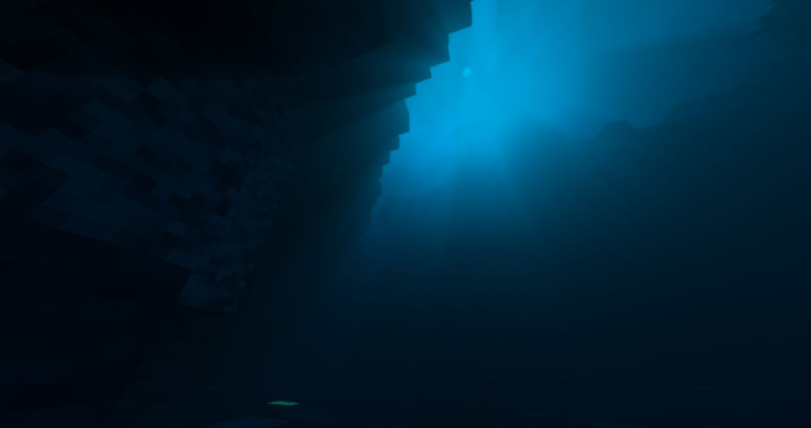
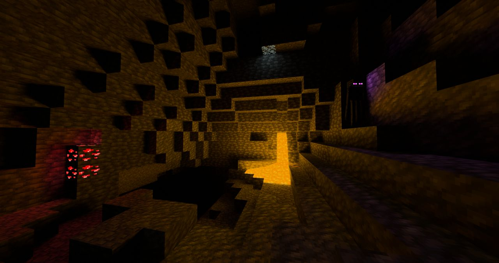
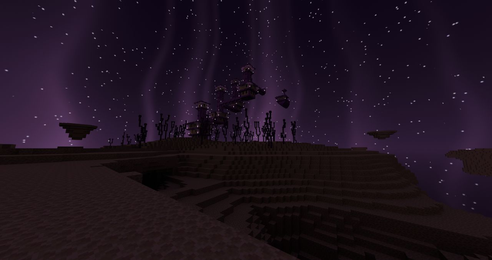

[English](README.md) | [Русский](README.ru.md) | [繁體中文](README.zh-TW.md) | **简体中文**

# ParacosmShader

适用于 [Radiance](https://github.com/Minecraft-Radiance/Radiance)（MCVR）的路径追踪光影包。Radiance 是 Minecraft 的 Vulkan 光线追踪模组。本光影包基于 Radiance 内置的 **Advanced** 光影包修改而来，在光影包列表中显示为 **Paracosm Shader**。

ParacosmShader 是一个合作项目，整合了 TimON 的 Advanced Sunlit 成果，以及 Akiraoo 的 [Chromance-VKPT](https://github.com/Akiraoo/Chromance-VKPT) 光影包的部分内容。

## 截图

  

<table>
  <tr>
    <td width="50%"> 白天与云</td>
    <td width="50%"> 水下</td>
  </tr>
  <tr>
    <td width="50%"> 洞穴：岩浆与发光红石矿石</td>
    <td width="50%"> 末地</td>
  </tr>
</table>

## 特性

- **日光与天空**：强烈的直射阳光（正午太阳与天空亮度比约为 5:1），更柔和的黄金时刻，更清晰、更蓝的远景雾气，以及边缘柔和变暗的圆形太阳。
- **夜空**：独有的星星、星云和遥远星系，会随太阳和月亮转动；在寒冷生物群系（或每晚）还有极光。
- **云**：体积云，以及高空的薄卷云层。
- **水**：带有细腻涟漪的平静水面、清澈的青绿色浅水、焦散，以及渐变为深蓝色的深水。
- **方块光照**：发光方块有两种光照模式：
  - **ReSTIR**（默认）：平滑的光照，在时间上和像素之间复用。
  - **RIS**：Chromance 的光源采样方法；没有历史数据，因此光照不会滞后或拖影。
- **发光方块**：为岩浆块、发光红石矿石和发光地衣单独设置亮度；发光的生物眼睛不再消失。
- **线性纹理颜色**：纹理和生物群系颜色从 sRGB 解码，因此保持对比度，不会显得苍白发灰。
- **第一人称身体**（可选）、带光束和星星的**末地**天空，以及**后期处理**（对比度、锐化、饱和度、鲜艳度）。

## 系统要求

- Minecraft 1.21.4（Fabric）
- Radiance（MCVR）0.1.6
- 支持硬件光线追踪的 GPU（推荐 NVIDIA RTX；DLSS 光线重建可获得最干净的画面）

## 安装

1. 从 [Releases](https://github.com/Akiraoo/ParacosmShader/releases/latest) 下载光影包（或克隆本仓库）到 `<minecraft 实例>/shaderpacks/`。文件夹和 zip 压缩包均可使用。
2. 进入游戏，打开 Radiance 设置，前往光影包页面并选择 **Paracosm Shader**。
3. 更新光影包后，请在光影包设置页面点击 **Reset all**（全部重置）。Radiance 会在首次加载光影包时保存每项设置的值，因此新的默认值只有在重置后才会生效。

## 参与贡献

所有更改都通过 Pull Request 提交：从 `main` 创建分支，完成修改后发起 Pull Request。另一位维护者会在游戏中测试后再合并。

## 致谢

- **TimON**（[Tarry665](https://github.com/Tarry665)）：Advanced Sunlit — 日光、天空、夜空、极光、水、云、末地天空、第一人称身体、后期处理。
- **Akiraoo**（[Akiraoo](https://github.com/Akiraoo)）：Chromance-VKPT — RIS 光源采样方法和云的相关工作。
- **Radiance 团队**：Radiance 模组及其内置的 Advanced 光影包，本光影包以此为基础。

## 许可证

ParacosmShader 采用 GPL-3.0 许可证发布。详情请见 [LICENSE](LICENSE)。
