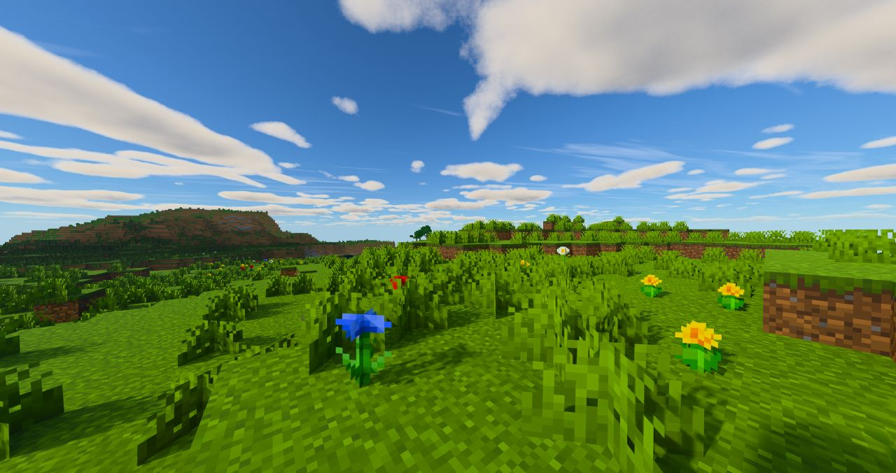
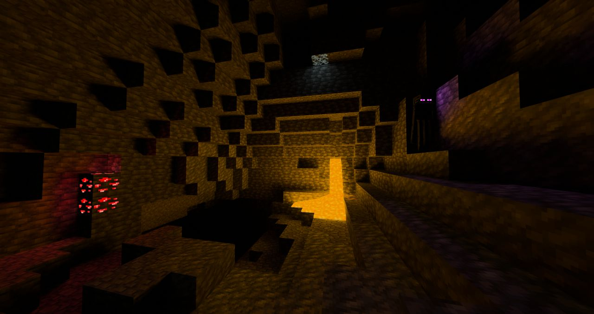
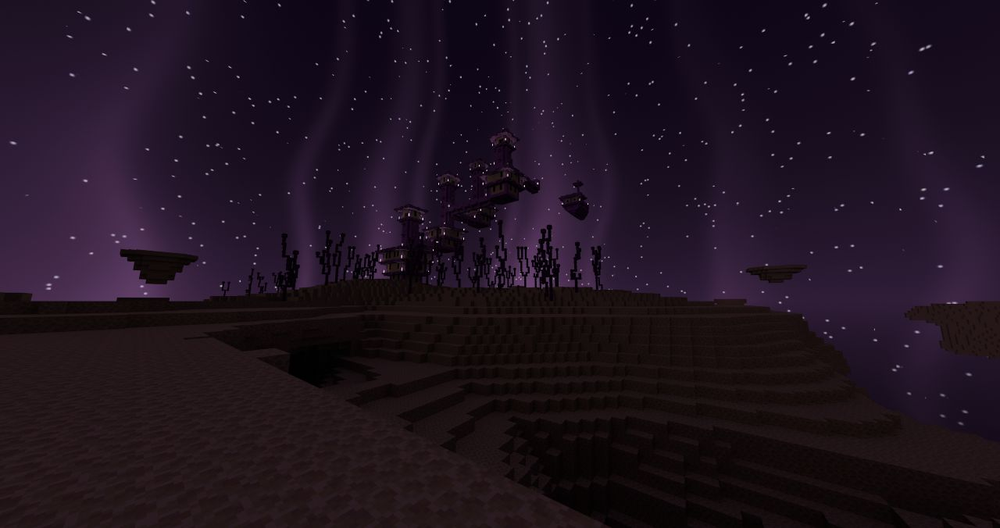

[English](README.md) | [Русский](README.ru.md) | **繁體中文** | [简体中文](README.zh-CN.md)

# ParacosmShader

適用於 [Radiance](https://github.com/Minecraft-Radiance/Radiance)（MCVR）的路徑追蹤光影包。Radiance 是 Minecraft 的 Vulkan 光線追蹤模組。本光影包基於 Radiance 內建的 **Advanced** 光影包修改而來，在光影包列表中顯示為 **Paracosm Shader**。

ParacosmShader 是一個合作專案，整合了 TimON 的 Advanced Sunlit 成果，以及 Akiraoo 的 [Chromance-VKPT](https://github.com/Akiraoo/Chromance-VKPT) 光影包的部分內容。

## 截圖

  

<table>
  <tr>
    <td width="50%"> 白天與雲</td>
    <td width="50%"> 水下</td>
  </tr>
  <tr>
    <td width="50%"> 洞穴：岩漿與發光紅石礦石</td>
    <td width="50%"> 終界</td>
  </tr>
</table>

## 特色

- **日光與天空**：強烈的直射陽光（正午太陽與天空亮度比約為 5:1），更柔和的黃金時刻，更清晰、更藍的遠景霧氣，以及邊緣柔和變暗的圓形太陽。
- **夜空**：獨有的星星、星雲和遙遠星系，會隨太陽和月亮轉動；在寒冷生物群系（或每晚）還有極光。
- **雲**：體積雲，以及高空的薄卷雲層。
- **水**：帶有細緻漣漪的平靜水面、清澈的青綠色淺水、焦散，以及漸變為深藍色的深水。
- **方塊光照**：發光方塊有兩種光照模式：
  - **ReSTIR**（預設）：平滑的光照，在時間上和像素之間重複利用。
  - **RIS**：Chromance 的光源取樣方法；沒有歷史資料，因此光照不會滯後或拖影。
- **發光方塊**：為岩漿塊、發光紅石礦石和發光地衣單獨設定亮度；發光的生物眼睛不再消失。
- **線性紋理顏色**：紋理和生物群系顏色從 sRGB 解碼，因此保持對比度，不會顯得蒼白灰濛。
- **第一人稱身體**（可選）、帶光束和星星的**終界**天空，以及**後期處理**（對比度、銳化、飽和度、鮮豔度）。

## 系統需求

- Minecraft 1.21.4（Fabric）
- Radiance（MCVR）0.1.6
- 支援硬體光線追蹤的 GPU（建議使用 NVIDIA RTX；DLSS 光線重建可獲得最乾淨的畫面）

## 安裝

1. 從 [Releases](https://github.com/Akiraoo/ParacosmShader/releases/latest) 下載光影包（或複製本儲存庫）到 `<minecraft 實例>/shaderpacks/`。資料夾和 zip 壓縮檔均可使用。
2. 進入遊戲，開啟 Radiance 設定，前往光影包頁面並選擇 **Paracosm Shader**。
3. 更新光影包後，請在光影包設定頁面按下 **Reset all**（全部重設）。Radiance 會在首次載入光影包時儲存每項設定的值，因此新的預設值只有在重設後才會生效。

## 參與貢獻

所有變更都透過 Pull Request 提交：從 `main` 建立分支，完成修改後發起 Pull Request。另一位維護者會在遊戲中測試後再合併。

## 致謝

- **TimON**（[Tarry665](https://github.com/Tarry665)）：Advanced Sunlit — 日光、天空、夜空、極光、水、雲、終界天空、第一人稱身體、後期處理。
- **Akiraoo**（[Akiraoo](https://github.com/Akiraoo)）：Chromance-VKPT — RIS 光源取樣方法和雲的相關工作。
- **Radiance 團隊**：Radiance 模組及其內建的 Advanced 光影包，本光影包以此為基礎。

## 授權

ParacosmShader 採用 GPL-3.0 授權發布。詳情請見 [LICENSE](LICENSE)。
